<p align="center">
  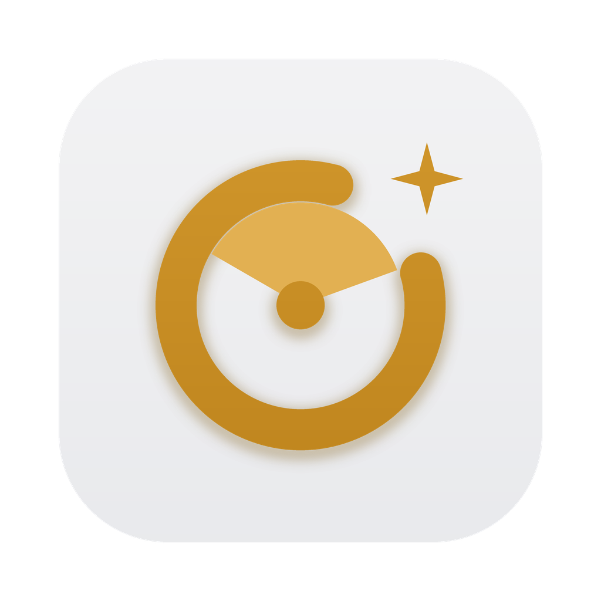
  &nbsp;&nbsp;
  
</p>

<h1 align="center">Swep</h1>

<p align="center"><b>Swep is an AI disk cleaner</b> for macOS, Windows and Linux. Its built-in AI finds and scores junk, leftovers and caches, explains every choice and tidies your contacts; it also repairs a damaged system, uninstalls apps with every leftover, and finds duplicates, empty folders and large files. Nothing is removed until you say so.</p>

<p align="center">
  <a href="https://ipconfig.co.network/swep"></a>
  <a href="https://github.com/JKS-sys/swep-releases-30-sep-2026/releases/latest"></a>
  <a href="https://github.com/JKS-sys/swep-releases-30-sep-2026/releases"></a>
  
</p>

<p align="center">⭐ <b>If Swep saves you space, please star this repository</b> — it helps other people find it. ⭐</p>

<p align="center">
  <a href="https://ipconfig.co.network/swep">Website</a> ·
  <a href="https://github.com/JKS-sys/swep-releases-30-sep-2026/releases/latest">Latest release</a> ·
  <a href="https://github.com/JKS-sys/swep-releases-30-sep-2026/releases">All releases</a> ·
  <a href="https://ipconfig.co.network/updates/swep/RELEASE_NOTES.md">Release notes</a>
</p>

<p align="center">
  <a href="https://ipconfig.co.network/swep">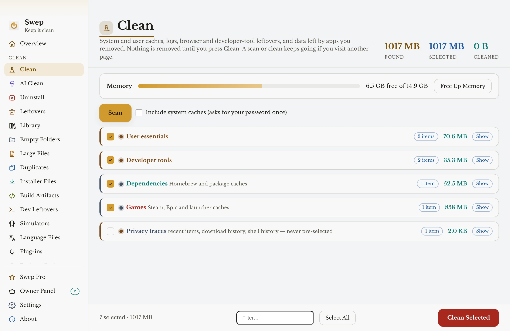</a>
  <br><sub>The website, <a href="https://ipconfig.co.network/swep">ipconfig.co.network/swep</a>, has every download, the release notes and the Pro plans.</sub>
</p>

## Download Swep 0.2.12 (15-oct-2026)

Easiest, on every system: install [Pour](https://ipconfig.co.network/pour), then `pour install --cask swep`.

| System | Download |
|---|---|
| macOS, Apple Silicon | [Swep_0.2.12_aarch64.dmg](https://github.com/JKS-sys/swep-releases-30-sep-2026/releases/download/v0.2.12/Swep_0.2.12_aarch64.dmg) |
| macOS, Intel | [Swep_0.2.12_x64.dmg](https://github.com/JKS-sys/swep-releases-30-sep-2026/releases/download/v0.2.12/Swep_0.2.12_x64.dmg) |
| Windows (x64) | [Swep_0.2.12_x64-setup.exe](https://github.com/JKS-sys/swep-releases-30-sep-2026/releases/download/v0.2.12/Swep_0.2.12_x64-setup.exe) |
| Windows (ARM64) | [Swep_0.2.12_arm64-setup.exe](https://github.com/JKS-sys/swep-releases-30-sep-2026/releases/download/v0.2.12/Swep_0.2.12_arm64-setup.exe) |
| Linux (AppImage, x86_64) | [Swep_0.2.12_amd64.AppImage](https://github.com/JKS-sys/swep-releases-30-sep-2026/releases/download/v0.2.12/Swep_0.2.12_amd64.AppImage) |
| Linux (Debian/Ubuntu, x86_64) | [Swep_0.2.12_amd64.deb](https://github.com/JKS-sys/swep-releases-30-sep-2026/releases/download/v0.2.12/Swep_0.2.12_amd64.deb) |
| Linux (Debian/Ubuntu, ARM64) | [Swep_0.2.12_arm64.deb](https://github.com/JKS-sys/swep-releases-30-sep-2026/releases/download/v0.2.12/Swep_0.2.12_arm64.deb) |
| FreeBSD (x86_64) | [Swep_0.2.12_freebsd_amd64.tar.gz](https://github.com/JKS-sys/swep-releases-30-sep-2026/releases/download/v0.2.12/Swep_0.2.12_freebsd_amd64.tar.gz) |

A file missing from the release did not build this time; the website always has the newest of each.

The command-line tool `sp` is inside the macOS app (Swep Pro).

## Install

**With Pour (macOS, Linux, Windows, FreeBSD)** — one line installs Pour, the next installs Swep and keeps it up to date:

```bash
curl -fsSL https://ipconfig.co.network/pour/install | sh
pour install --cask swep
```

On Windows (PowerShell): download [`pour-windows-x86_64.exe`](https://ipconfig.co.network/pour/dl/pour-windows-x86_64.exe), then `pour install --cask swep`.

**One line without Pour (macOS)** — downloads the newest signed release, checks it, and puts Swep in /Applications:

```bash
curl -fsSL https://ipconfig.co.network/updates/swep/install.sh | bash
```

**Downloads:** [ipconfig.co.network/swep](https://ipconfig.co.network/swep) or the [latest GitHub release](https://github.com/JKS-sys/swep-releases-30-sep-2026/releases/latest) — `.dmg` for macOS (Apple Silicon and Intel), `_x64-setup.exe` and `_arm64-setup.exe` for Windows, `.deb` (x86_64 and ARM64) and `.AppImage` for Linux, `.tar.gz` for FreeBSD.

**Linux:** `sudo apt install ./Swep_*_amd64.deb` (or `_arm64.deb`), or `chmod +x Swep_*_amd64.AppImage && ./Swep_*_amd64.AppImage`.
**ChromeOS:** turn on Linux (Settings → Advanced → Developers), then install the `.deb` the same way — Swep appears in the launcher under Linux apps.
**FreeBSD:** `pkg install gtk3 webkit2-gtk_41 libsoup3 librsvg2-rust`, unpack `Swep_*_freebsd_amd64.tar.gz` and run `./swep` (updates by hand from the releases page).
**Windows:** run `Swep_*_x64-setup.exe` (ARM64 PCs: `_arm64-setup.exe`).
**Haiku and other systems:** Swep's window needs a WebView that Haiku does not offer to apps like Swep yet; reach such a computer from Swep over SSH (Devices → Computers (SSH)).
**The sp command** comes inside the app: Settings → Command line → Install sp (Swep Pro).

## See it move

<table>
  <tr>
    <td width="50%" valign="top"><br><b>Starting up</b> — The mark draws itself, the name rises, “the AI disk cleaner” types itself and the byline lands — with a chime. Any key skips it.</td>
    <td width="50%" valign="top"><br><b>AI Clean</b> — Swep’s own model scores every candidate from 0 to 100 and says why; the sure ones are ticked, you remove what you agree with, and the result lands with a sweep.</td>
  </tr>
  <tr>
    <td width="50%" valign="top"><br><b>Every device at once</b> — The Devices page lists this computer, external disks, cloud accounts, SSH computers, iPhones and Android phones — then “Large Files everywhere” scans them one after another and groups the results by device.</td>
    <td width="50%" valign="top">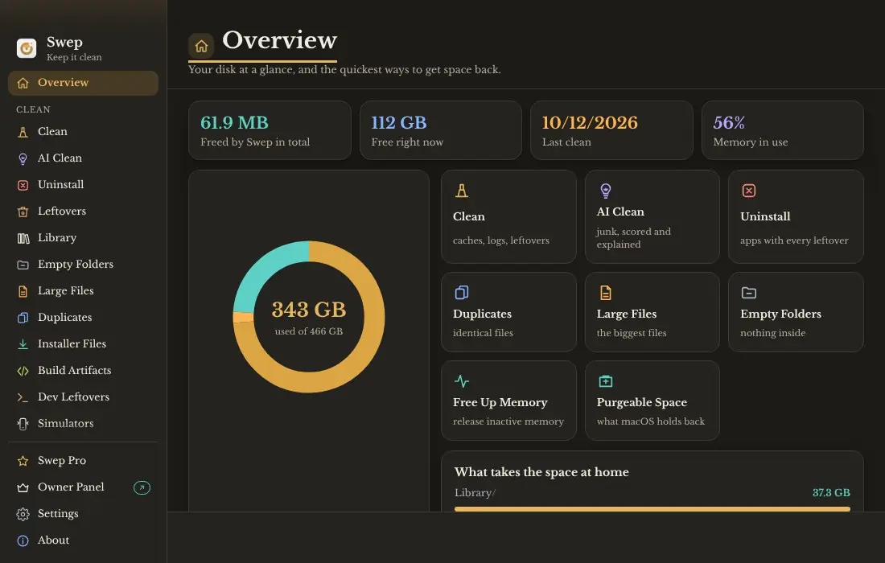<br><b>The Library, folder by folder</b> — Everything in Containers, Group Containers, Caches and the other Library folders, each with its verdict: Apple, an installed app (which one), a developer’s shared folder, a leftover, or unknown. Select Leftovers ticks the sure ones.</td>
  </tr>
  <tr>
    <td width="50%" valign="top">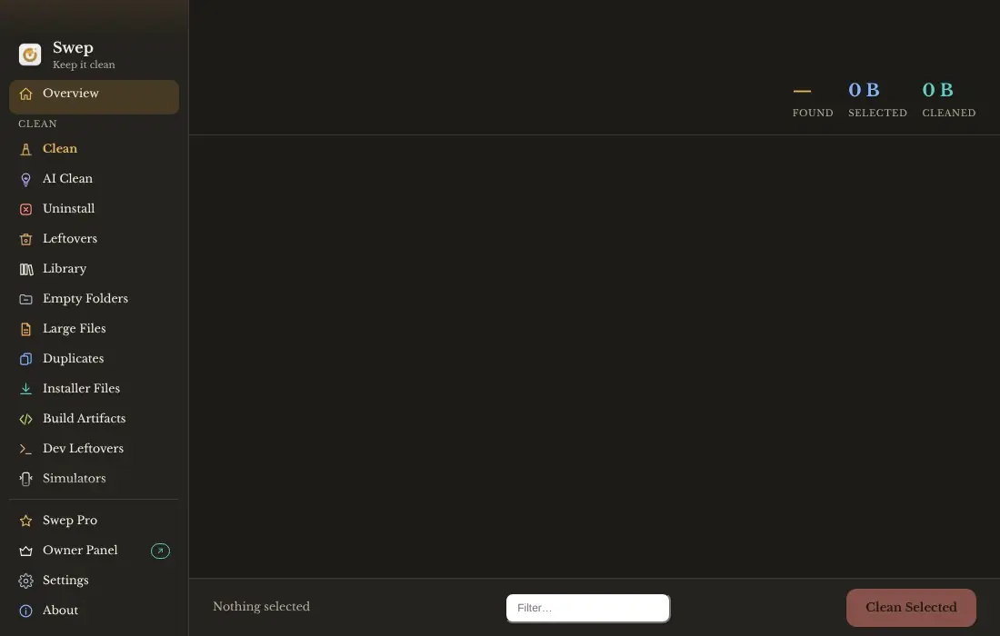<br><b>Many things at once</b> — Start a Clean scan, look at Status and Large Files meanwhile, come back: the scan kept going, and every page is exactly as you left it.</td>
    <td width="50%" valign="top"><br><b>System Repair</b> — Checks the disk, the sealed system, settings files, apps and services side by side, then repairs what you tick with the system’s own tools — one password for all of it.</td>
  </tr>
  <tr>
    <td width="50%" valign="top">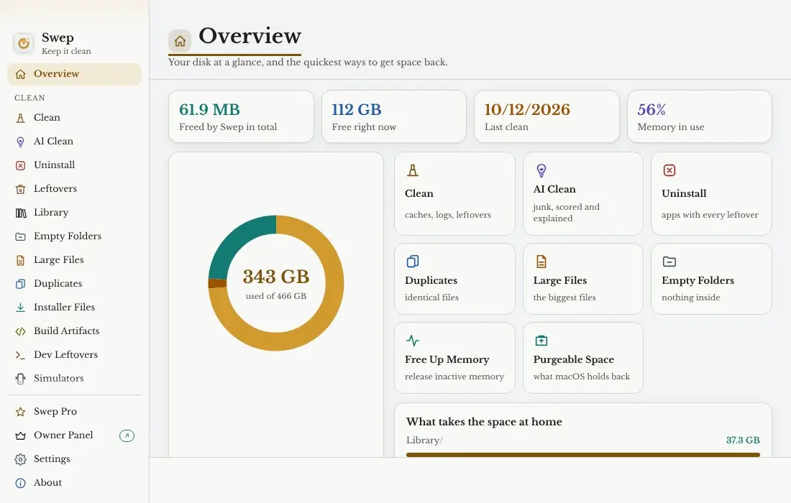<br><b>Cloud storage</b> — Large files of every kind right on S3-compatible storage, OneDrive or Google Drive, then duplicates by the service’s own checksums, and Recheck All Accounts to find the one that signed out.</td>
    <td width="50%" valign="top"><br><b>iPhone and Android</b> — Apps on an iPhone with the space each takes, removed over USB; then an Android phone’s preinstalled bloatware, removed (and restorable) the same way.</td>
  </tr>
  <tr>
    <td width="50%" valign="top"><br><b>Plug-ins, simulators, languages</b> — Audio Units, VSTs, Quick Look and other plug-ins with their problems; Xcode’s simulators and device-support files; the languages apps carry that you never use.</td>
    <td width="50%" valign="top">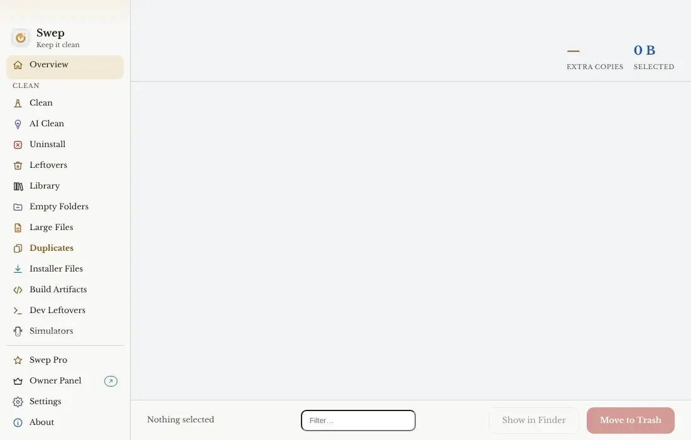<br><b>Pictures that look the same</b> — Beyond byte-for-byte duplicates: resized, re-saved and lightly edited copies of the same picture, grouped, with the largest kept.</td>
  </tr>
  <tr>
    <td width="50%" valign="top"><br><b>Right-click everywhere</b> — Rows, groups and pages have their own menus — Show in Finder, Copy path, Analyze this folder, Find here…, Protect, Remove this — with keyboard shortcuts shown.</td>
    <td width="50%" valign="top">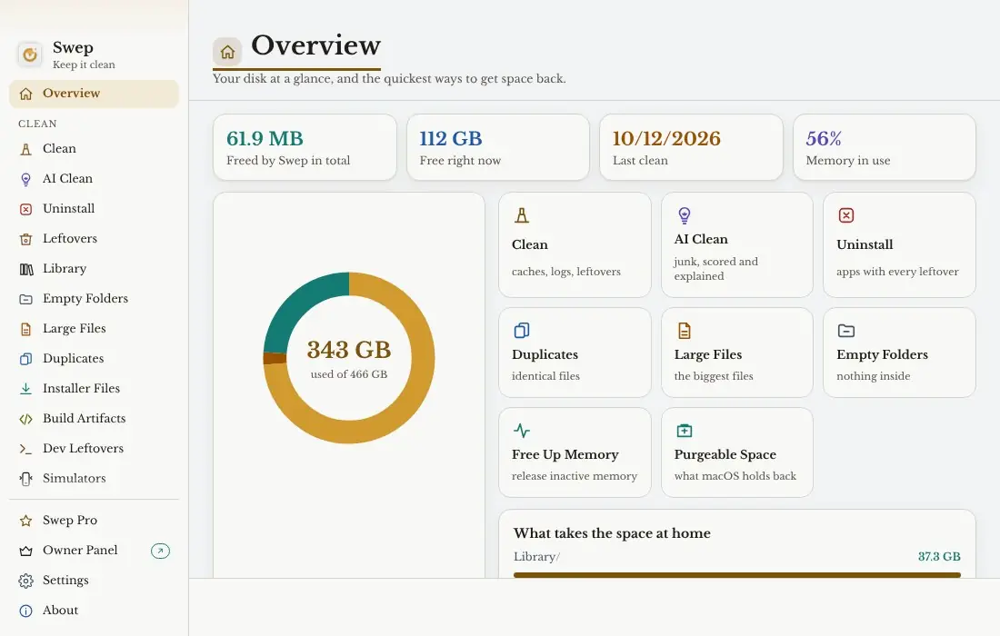<br><b>Leftovers, judged by a local AI</b> — Apps you dragged to the Trash sit at the top with what they left behind; Ask Local AI lets the model on your Mac judge every item and tick what it is sure about.</td>
  </tr>
  <tr>
    <td width="50%" valign="top">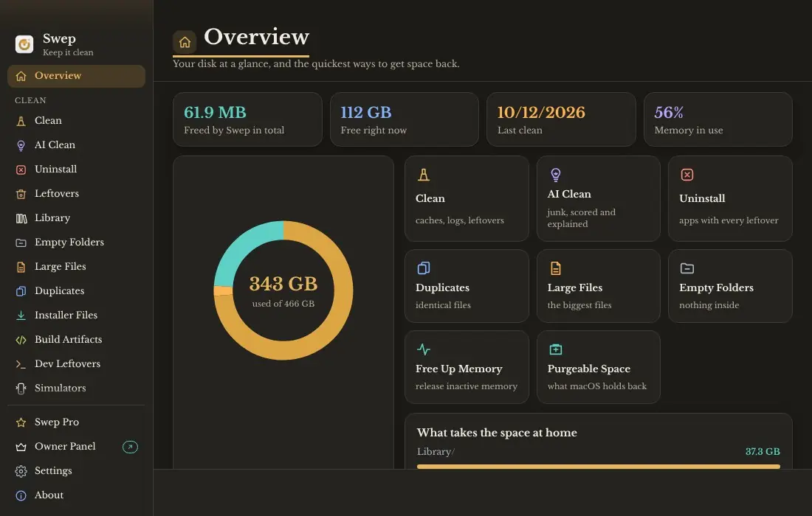<br><b>Contacts, tidied by AI</b> — Long, cluttered contact names become clean names; the extra words go into the note, so nothing is lost.</td>
    <td width="50%" valign="top"><br><b>Updating</b> — Swep says when a new version is ready; one window downloads, checks the signature, installs — then Restart Now.</td>
  </tr>
  <tr>
    <td width="50%" valign="top">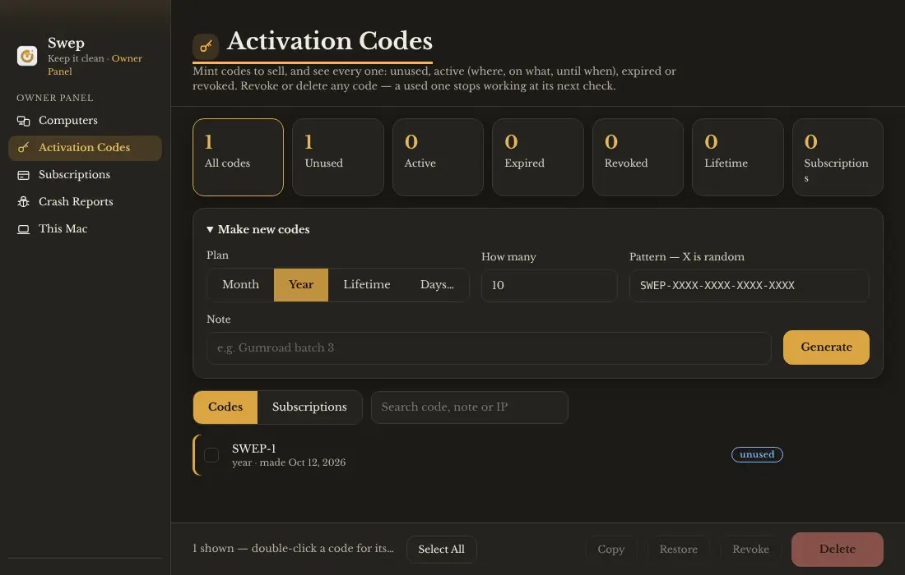<br><b>Owner Panel</b> — In its own window: the computers using Swep (active today, this week, this month), every subscription with the computers it is used on, invoices and actions, and the crash reports people send.</td>
    <td width="50%" valign="top"><br><b>Package managers and receipts</b> — What each package manager installed, with sizes; the receipts .pkg installers left behind, including those whose app is long gone. (Recorded before the Homebrew page became the Pour page.)</td>
  </tr>
</table>

## What it looks like

<table>
  <tr>
    <td width="50%" valign="top"><a href="assets/clean.webp"></a><br><b>Clean</b> — one scan finds user and system caches, logs, every browser’s cache, developer tools, games and data left by removed apps; nothing goes until you press Clean, and the scan keeps running if you visit other pages.</td>
    <td width="50%" valign="top"><a href="assets/library.webp"></a><br><b>Library</b> — every folder in Containers, Group Containers, Caches, Application Support and more, with who it belongs to — remove any of them.</td>
  </tr>
  <tr>
    <td width="50%" valign="top"><a href="assets/devices.webp"></a><br><b>Devices</b> — this Mac, external disks, cloud accounts, SSH computers, iPhones and Android phones, each with its own buttons, and three that run everywhere at once.</td>
    <td width="50%" valign="top"><a href="assets/plugins.webp"></a><br><b>Plug-ins</b> — audio units, VSTs, Quick Look previews, Spotlight importers, preference panes and fonts, with CPU-slice, signature and developer checks.</td>
  </tr>
  <tr>
    <td width="50%" valign="top"><a href="assets/repair.webp"></a><br><b>System Repair</b> — the startup disk, the sealed system, Gatekeeper, damaged apps and settings files, Spotlight, caches and updates — repaired with the system’s own tools.</td>
    <td width="50%" valign="top"><a href="assets/cloud.webp"></a><br><b>Cloud & Servers</b> — large files of every kind, empty folders and duplicates right on S3, OneDrive, Google Drive, Dropbox and SFTP computers.</td>
  </tr>
  <tr>
    <td width="50%" valign="top"><a href="assets/duplicates.webp"></a><br><b>Duplicates</b> — identical files by full SHA-256, or pictures that look the same — the largest copy kept.</td>
    <td width="50%" valign="top"><a href="assets/iphone.webp">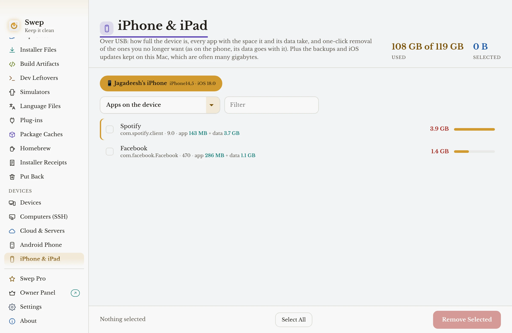</a><br><b>iPhone & iPad</b> — apps with the space each takes, removed over USB; backups and iOS updates kept on this Mac.</td>
  </tr>
  <tr>
    <td width="50%" valign="top"><a href="assets/settings.webp">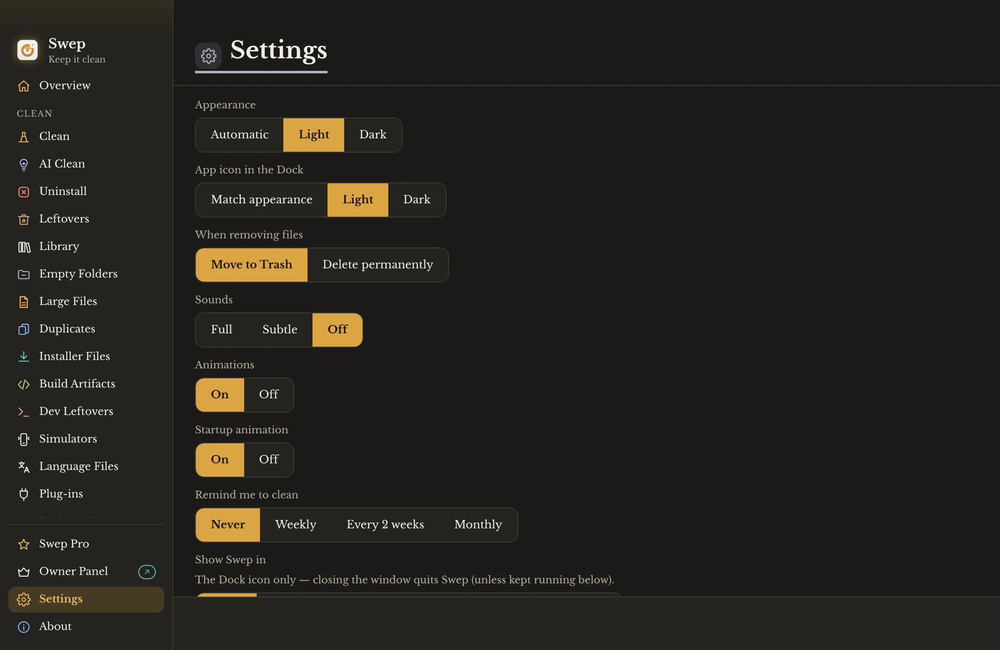</a><br><b>Settings</b> — show Swep in the Dock, the menu bar, both or neither; keep it running when the window closes; notifications; Finder right-click actions.</td>
    <td width="50%" valign="top"><a href="assets/pro.webp">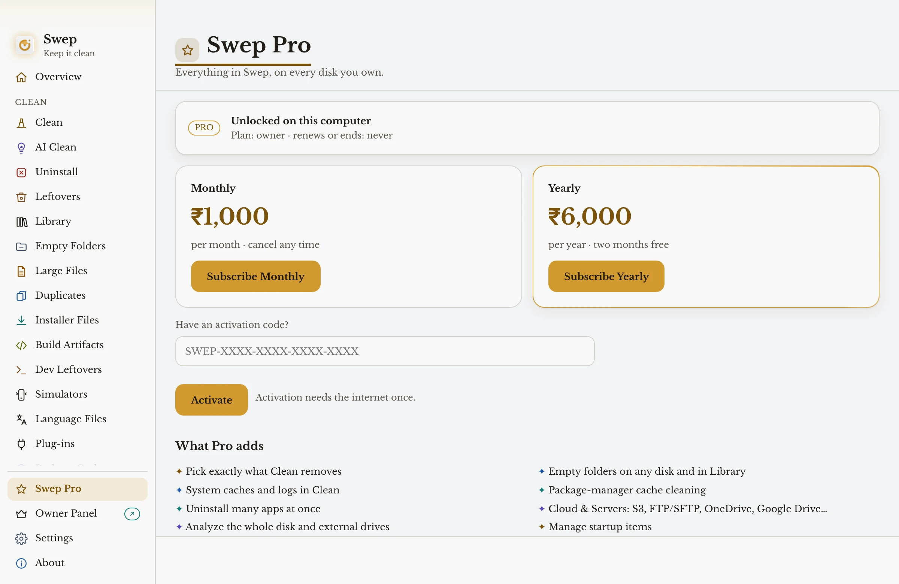</a><br><b>Swep Pro</b> — ₹1,000 a month or ₹6,000 a year on two computers, or an activation code. Everything in Free, plus the whole disk, every app at once and the sp command.</td>
  </tr>
  <tr>
    <td width="50%" valign="top"><a href="assets/owner-computers.webp">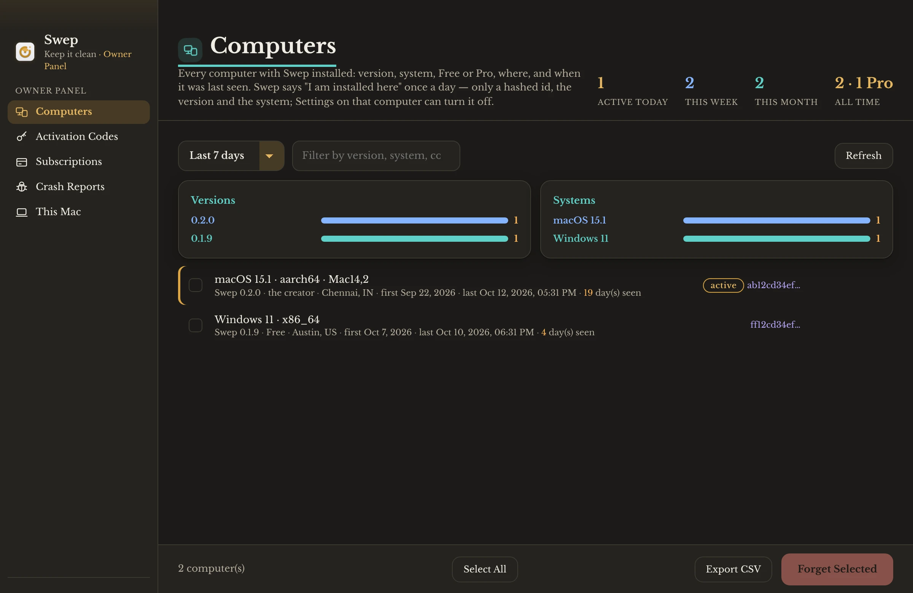</a><br><b>Owner Panel · Computers</b> — how many computers use Swep today, this week and this month, by version and system — with the computers each licence is used on.</td>
    <td width="50%" valign="top"><a href="assets/history.webp">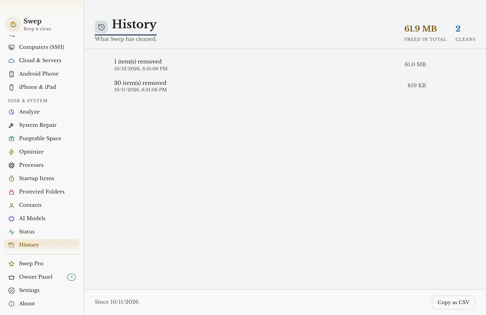</a><br><b>History</b> — every clean, when it happened and how much it freed, with CSV export.</td>
  </tr>
</table>

## Free and Pro

| | Free | Pro (₹1,000/month · ₹6,000/year · or an activation code · two computers) |
|---|:---:|:---:|
| Clean: caches, logs, developer leftovers, app caches, games, temporary files | ✓ | ✓ |
| Clean: untick individual items before cleaning; system caches | | ✓ |
| AI Clean: Swep's built-in model scores junk, AI-tool caches, leftovers and unwanted downloads, explains each one, and removes what you agree with | ✓ | ✓ |
| AI Clean: a second opinion from a language model running on your computer (Ollama, LM Studio) | | ✓ |
| Leftovers, Installer Files, Build Artifacts, Dev Leftovers | ✓ | ✓ |
| Empty Folders, Large Files, Duplicates, Analyze — in your home folder | ✓ | ✓ |
| …on other disks, network shares and cloud folders (iCloud Drive, OneDrive, Google Drive, Dropbox) | | ✓ |
| Uninstall apps with every leftover — one at a time (your password asked once at most) | ✓ | ✓ |
| Uninstall many apps at once; find apps you have not opened for months | | ✓ |
| Package Caches, Startup Items | | ✓ |
| Cloud & Servers (S3, FTP/SFTP, OneDrive, Google Drive… via rclone) | | ✓ |
| AI Models: find and remove local models (Ollama, LM Studio, Hugging Face, .gguf…) | ✓ | ✓ |
| Contacts: view every field, export a .vcf that iCloud, Google and phones accept | ✓ | ✓ |
| Contacts: fix numbers and duplicates, edit, add, delete, import, send between accounts and iCloud accounts | | ✓ |
| Overview, Purgeable Space, Free Up Memory, Status (battery and SSD health), History, Protected Folders, Touch ID for sudo | ✓ | ✓ |
| The `sp` command line (previews are free; making changes is Pro) | | ✓ |

## What's new in 0.2.12

- Fixed: the release stopped silently right after "5 build(s), 2 at a time". The build board looked up a log that was still empty, and under the script's strict mode an empty lookup ended everything without a word. Every lookup on the board now tolerates an empty log, and if anything ever stops update.sh unexpectedly it now prints the line and command where it stopped.
- Fixed: turning the Dock or menu-bar icon off and on could crash Swep or leave a dead icon behind. The menu-bar icon is now removed by its id and made only when none exists; the change runs on the main thread, any panic in there is caught and written to the log, and coming back to the Dock puts the chosen app icon and the window back.
- New: the menu-bar icon's left click opens a quick panel — free space as a ring, what Swep has freed, and twelve one-click actions (Clean Now, AI Clean, Free Memory, Leftovers, Large Files, Duplicates, Uninstall, Pour, Plug-ins, Repair, Status, Settings). Double click opens the window; Esc or clicking elsewhere hides the panel.
- New: a much bigger right-click menu on the menu-bar icon and the Dock icon — free space at the top, Open, Quick Panel, Clean Now, AI Clean, Free Memory, then Clean, Apps and Plug-ins, System, Devices, Appearance (theme, sounds, animations), Swep Lives In (switch between Dock and menu bar right there) and Window and Help (show, hide, compact, large, centre, shortcuts, updates, about, website, star on GitHub, log folder), Settings, Pro, Account and the Owner Panel.
- New Finder right-click actions: Find Small Junk Here, Remove Unused Languages (on an app), Find Leftovers of This App, and Delete Immediately (skips the Trash, asks first) — twelve in all.
- Right-click inside Swep: on a row — Open, Quick Look, Get Info, Open a Terminal here, Copy (path, name, folder, size, the row); on a group — copy the group, or remove the whole group; anywhere — Layout, Appearance, Window, Swep Lives In and Settings.
- Log boxes everywhere: crash reports, search results and command output in dialogs are shown in the same log box (coloured by kind, Copy and Expand).
- Leftovers: home dot-folders that apps leave behind (~/.vscode, ~/.cursor, ~/.windsurf, ~/.zoomus, ~/.android, ~/.orbstack, ~/.lmstudio, ~/.atom, ~/.zed, ~/.arduino15 and more) once the app is gone, plus folders named after removed apps in ~/.config, ~/.local/share and Sentry's crash cache (the desktop's own folders are never touched).
- Plug-ins: editor extensions (VS Code, VS Code Insiders, VSCodium, Cursor, Windsurf, Sublime Text) with older copies of updated extensions marked, keyboard layouts and alert sounds.
- AI Clean: Xcode test results (.xcresult) older than two weeks, crash reports saved as files (.crash, .ips) and TypeScript build records.
- Language Files: spelling dictionaries inside apps (dictionaries, hunspell; .dic, .aff, .bdic).
- Five new sounds with their own pictures: the Dock and menu bar switching, Quick Look, Get Info, a background service found among the leftovers, and editor extensions removed.
- More colour: sidebar headings, every settings row, dialog titles, key lists and menu headings each take their own hue (no pink).

On macOS, if the app is reported as damaged, run: `xattr -cr /Applications/Swep.app`

## Features

- **AI disk cleaning** — Swep is an AI disk cleaner: its own model (offline, free for everyone) scores every candidate from 0 to 100 and explains itself; a model on your computer (Ollama, LM Studio) or Swep's free online AI can give a second opinion and shorten long contact names and notes.
- **Overview** — your disk as a ring (used, purgeable, free), what Swep has freed in total, when it last cleaned, and one-click ways in.
- **Clean** — system and user caches, logs, every browser's cache (Chrome, Edge, Brave, Arc, Vivaldi, Opera, Firefox, LibreWolf, Zen…), developer tools, chat and media apps, games, and data left by removed apps — with a full preview first. A scan or a clean keeps going while you visit other pages, and is waiting when you come back. Pro can untick anything and include system caches.
- **AI Clean** — Swep's own model scores AI-tool caches (Ollama, LM Studio, Hugging Face, PyTorch, Claude, ChatGPT, Codex, Cursor…), tiny junk (.DS_Store, __MACOSX, ._ files, broken shortcuts, abandoned downloads, Python caches), leftovers of removed apps and unwanted downloads from 0 to 100, says why in words, ticks what it is sure about, and removes what you agree with. Works offline, for everyone. Pro can ask a local language model for a second opinion.
- **Uninstall** — every leftover of an app (caches, preferences, containers, launch agents, logs) listed with its size before anything goes; your password is asked once at most, however many apps you remove together. See which apps you have not opened for months. Pro removes many apps at once.
- **Leftovers** — data from apps you already deleted — including background services and privileged helpers that keep running as administrator for every user — in Containers, Group Containers (including developer-team folders like `UBF8T346G9.Office`), Caches, Application Support, preferences, saved state, cookies and logs — matched by bundle identifier, by developer, by Spotlight's list of every app on every disk, and, more carefully, by folder name.
- **System Repair** — finds signs of a damaged operating system or damaged system files and repairs them with the system's own tools: the startup disk (First Aid), the sealed system volume and System Integrity Protection, Gatekeeper, damaged apps, unreadable preference files, files in your home that belong to the administrator, home-folder permissions, Spotlight, app associations, icon and font caches, maintenance scripts and pending updates — on Windows System File Checker, DISM, chkdsk and Windows Update; on Linux broken packages, changed package files and failed services. One password for all of it.
- **Processes** — what is running and how much memory it uses; quit or force quit what you don't need (system processes are never offered).
- **Put Back** — everything Swep moved to the Trash, put back where it was in one click.
- **Works on every page at once** — start a scan, go elsewhere, come back: it kept working, and every page is exactly as you left it (the list, what you ticked, the folder, the filter). A Stop button (or Esc) ends work on purpose.
- **Empty Folders** — folders with nothing real inside, found on every core at once and removed safely (only if still empty).
- **Analyze** — what takes the space on the startup disk, your home folder or an external drive; folders measured in parallel and remembered.
- **Large Files** (by kind and age), **Installer Files** and **Build Artifacts** (node_modules, Rust target, Python venvs, Pods…).
- **Purgeable Space** — see how much macOS holds back as purgeable and reclaim it in one click.
- **Optimize** — DNS, Spotlight, QuickLook, LaunchServices, fonts, Dock and Finder refresh, plus a health and security check.
- **Developer Leftovers** — Rust caches and old toolchains, folders and broken commands left by removed tools, shell lines that point at them, Pour and Homebrew packages nothing needs, Xcode and simulator leftovers, Docker and OrbStack caches, and npm/Yarn/pnpm/Bun/pip/uv/Poetry/Go/CocoaPods/SwiftPM/Gradle/Maven/Conda/NuGet/Bazel caches. Part of every Clean.
- **Privacy traces** — recent-items lists, the download history record and shell histories, never pre-selected.
- **Protected Folders** — never cleaned, from any page or command.
- **Duplicates** — identical files by full SHA-256; the oldest copy is kept. **Contacts Fixer** — invalid numbers, repeats, duplicate contacts, empty contacts, country codes; contact photos (see, add, change, remove); AI that shortens long names (the extra words go into the note) and long notes (numbers, addresses and dates kept); in the Contacts app (iCloud, Google, Exchange sync) or a .vcf file; exports a .vcf that iCloud, Google and phones accept.
- **Everywhere** — Empty Folders, Large Files and Duplicates on external disks, network shares and cloud folders.
- **Cloud & Servers** — large files of every kind (videos, images, audio, documents, archives, disk images and installers, code and data) and empty folders right on S3 and S3-compatible storage (FileLu, Backblaze, Wasabi, R2…), FTP/SFTP, WebDAV, OneDrive, Google Drive, Dropbox, Box and every other rclone account; filter by kind, size (any size) and age. **Recheck All Accounts** tests every account at once, shows how full each is, and **Reconnect** signs an expired one in again.
- **Local AI** — install Ollama, download models with a progress bar (suggested ones for every Mac, or any model by name), choose the one Swep asks, remove models, and uninstall Ollama with or without its models. **Ask Local AI** on Leftovers lets that model judge every leftover, on this computer, and ticks what it is sure about.
- **Simulators** — every simulated iPhone, iPad, Watch and TV with its size, simulator runtimes, old device-support files, caches, SwiftUI previews, DerivedData — and Android Studio's emulators. Unused ones are ticked.
- **Language Files** — removes the languages apps carry that are not in Language & Region (English and Base stay), then signs the app again so it still opens; App Store apps, Apple's apps and apps using iCloud or the keychain are left alone.
- **Kept on purpose** — Leftovers also lists folders that look abandoned but were kept, each with the reason (installed where, running, shared by a developer's other apps, Shortcuts data), so you can remove one anyway.
- **Devices** — this computer, external disks, cloud accounts, other computers over SSH (Mac, Windows, Linux, ChromeOS, FreeBSD, Haiku…), iPhones and iPads, and Android phones on one page; Large Files, Empty Folders and Duplicates on every device at once. SSH computers run Swep's own `sp` for Clean, Leftovers, Apps and Empty Folders.
- **iPhone & iPad** — storage and every app with its size, removed over USB; backups and iOS updates kept on this Mac. **Android Phone** — storage (large files, empty folders, all app caches) and bloatware removal.
- **Library** — every folder in Containers, Group Containers, Caches, Application Support, Preferences and more, each with a verdict and its size; remove anything.
- **Plug-ins — a full audio plug-in uninstaller** — every AU, VST, VST3, CLAP, AAX, RTAS and LV2 plug-in in every folder and developer sub-folder (installed with an installer or copied in by hand), grouped across formats, with everything it brought along: presets, sound content, support folders, settings and the files its installer put elsewhere — never a file another plug-in shares. Remove a plug-in completely, a whole format your host never uses, the presets of plug-ins already gone, Audio Unit caches and GarageBand/Logic sound libraries; problems (wrong chip, broken signature, half-removed) are ticked. Also Quick Look, Spotlight, preference panes, screen savers, Final Cut/Motion, Adobe and OBS plug-ins, and fonts.
- **Notifications** (macOS) — what Notification Center keeps, app by app; clear all of an app's notifications or only the old ones, and take removed apps out of System Settings → Notifications.
- **Computers with Swep** — other computers on your network that run Swep appear by themselves; pair once (both screens show the same six digits, you press Allow on the other one) and they connect automatically from then on. Scan and clean them from here — no SSH, no `sp` — and work started from a Swep Pro computer runs with Pro on the other one. Encrypted and signed end to end.
- **One account for Pro** — sign in with your email (a 6-digit code, or a password), and Pro follows you to your other computer wherever you paid: a subscription in Swep, the website shop, an activation or gift code. See the computers holding Pro, free a seat, cancel a subscription, gift spare codes.
- **A log you can read** — every job (Pour, Clean, System Repair, a remote computer) streams into a log box with a live status, counts of steps, finished items, warnings and problems, numbered steps, commands on their own row, and errors in red and warnings in amber; copy it or make it taller.
- **Fast** — package managers, folders, plug-in receipts and AI Clean's searches all run side by side; the list of installed apps is read once for every page.
- **Eight layouts for every list** — list, compact, cards, tiles, board, timeline, magazine and masonry, remembered per page.
- **Show in** Dock / menu bar / both / background — switch from the menu itself; a quick panel under the menu-bar icon (free space, twelve one-click actions); big right-click menus on the menu-bar and Dock icons; twelve Finder right-click actions (Analyze, Large Files, Duplicates, Empty Folders, Small Junk, Uninstall, Unused Languages, Leftovers of an App, Remove, Delete Immediately, Protect, Check File System); right-click everywhere inside Swep (Open, Quick Look, Get Info, Terminal here, Copy…); notifications that open Swep.
- **Pour** — every package manager on the computer: Pour, Homebrew, MacPorts, Nix, pkgsrc, Fink, Conda, apt, dnf, pacman, zypper, Snap, Flatpak, FreeBSD pkg, Chocolatey, Scoop, WinGet, npm, pnpm, Yarn, Bun, Deno, Volta, nvm, fnm, pipx, Cargo, Go, rustup, pyenv, rbenv, asdf, mise and SDKMAN. It finds apps you deleted yourself that a manager still lists (with their command-line tools and cask/receipt folders), command links that point at nothing, caches, logs, old versions and unused dependencies, and the apps and tools you have not used for months — removed completely through their own manager. Remove a whole manager with its data and the lines it added to your shell files (backed up first), and **move everything from Homebrew to Pour** in one go: each tool and app is installed with Pour and checked, and only then is Homebrew removed.
- **Installer Receipts** — every .pkg installer's receipt: still installed, partly removed, or only a receipt of an app long gone; forget receipts, or remove a package with its files (never system files).
- **Android Phone** — remove the preinstalled apps (bloatware) on an Android phone over USB, with a guide to the well-known ones (safe / with care / needed by the phone); removed apps can be restored any time.
- **Apps in the Trash** — drag an app to the Trash and Swep notices the settings, caches and containers it left, and removes them in one click.
- **Uninstall on Windows and Linux** — Windows' installed programs (each app's own uninstaller, then its AppData and ProgramData folders); Flatpak, Snap and apt apps on Linux.
- **Corrupted settings put right** — Swep keeps a daily copy of every settings file that reads back clean; a damaged one is replaced with its last good copy through the system's settings service (so it sticks), not just deleted.
- **Status** — disk, memory, load, network, the apps using the most memory, battery health and cycles, SSD health, memory pressure and thermals.
- **Free Up Memory**, temporary files, Tauri and Rust caches, external-disk litter.
- **Touch ID for sudo**, **Remove Swep**, tab completion for `sp`, a clean reminder, crash reports and diagnostics in Settings — and one button to send a report to the creator (your name and folders are taken out first).
- **No surprise permission prompts** — Swep never wanders into folders macOS guards (Mail, Messages, Photos, other apps' data…) unless it has Full Disk Access or you open them yourself; Desktop, Documents and Downloads can be skipped too (Settings). Files go to the Trash through the system itself, never through Finder, so no Finder password dialogs.
- **Package Caches** and **Startup Items** (Pro) and **History** (with CSV export).
- Click, Shift-click, drag across rows, or hold Space with the arrow keys to select; filter any list; Trash or delete for good.
- Light and dark themes from the icon's palette with a readable rainbow for paths, sizes, numbers and brackets (no pink); a Dock icon that follows; sounds and animations for everything (both can be turned off).
- Closing the window quits completely. Updates are signed and checked before they install.

## Licence

Swep is **© 2026 Jagadeesh Kumar S. All rights reserved.** It is not open source and it is not under the MIT
licence: the source lives in a private repository, and the apps are free to use under the terms in
[LICENSE](https://github.com/JKS-sys/swep-releases-30-sep-2026/blob/main/LICENSE) — the Free edition on any number of your computers, Pro with an activation code or
subscription on two. The full text is also in the app under About → Licence.

The bundled cleaning runtime is a separate GPL-3.0 program; its own licence and notice ship inside `engine.tgz`
in the app (unpacked to `~/.swep/engine-…/LICENSE` and `NOTICE`) and are shown under About → Licence too. Swep is
built on the Tauri framework and on open-source Rust and JavaScript libraries, which keep their own licences.

---

<p align="center">⭐ <b>Found Swep useful? Please star this repository</b> — it is the easiest way to say thanks, and it helps others find it. ⭐</p>

Made by Jagadeesh Kumar S — [ipconfig.co.network/swep](https://ipconfig.co.network/swep) · [NewsCraft Studio](https://www.youtube.com/@JKS-sys)
